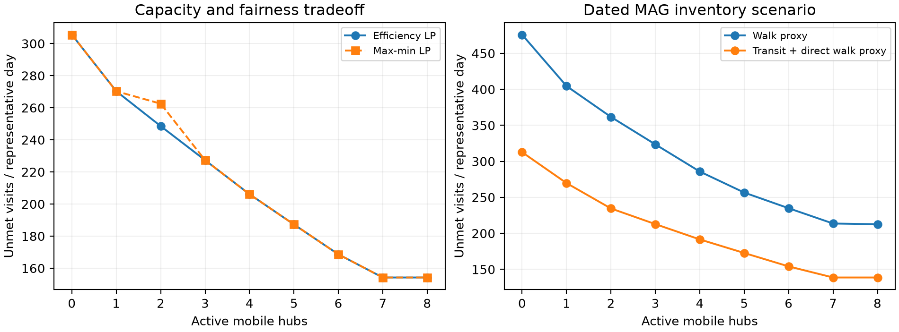
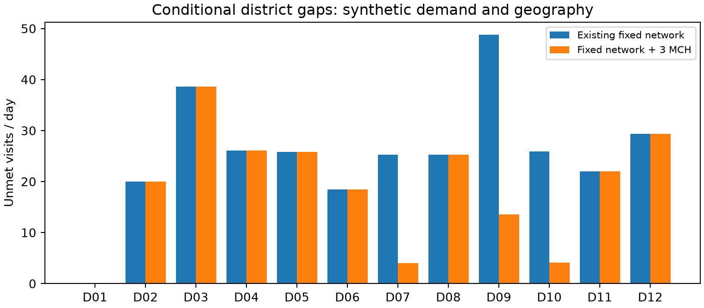

# 本轮冻结结果与解释

数值源提交：`d070f5d3a90929836d210f4e6002c9dbc00a8449`。结果/图均为条件模型输出，非真实覆盖或健康预测。

数值验收：**94 passed, 7 skipped, 1 warning in 7.86s**。跳过项原因完整保留于tests.log（旧保存结果不在本次稀疏工作树）。

## Q1—Q2：固定网络、移动站与公平

默认日需求505.000人次；固定网络缺口305.511，3辆MCH缺口227.295，所选MCH-3,MCH-7,MCH-8。

这是合成区/需求/候选位置和交通输入的条件结果，不能把这些编号当作已批准的实际部署点。

| p | 效率缺口 | max-min缺口 | 全区最差率(max-min) | 非豁免最差率 | 新增1辆的边际人次 |
|---|---|---|---|---|---|
| 0 | 305.511 | 305.511 | 1.000 | 1.000 | 0.000 |
| 1 | 270.286 | 270.286 | 1.000 | 1.000 | 35.225 |
| 2 | 248.547 | 262.520 | 1.000 | 0.575 | 21.739 |
| 3 | 227.295 | 227.295 | 1.000 | 0.575 | 21.252 |
| 4 | 206.097 | 206.097 | 1.000 | 0.575 | 21.198 |
| 5 | 187.256 | 187.256 | 1.000 | 0.575 | 18.841 |
| 6 | 168.631 | 168.631 | 1.000 | 0.575 | 18.625 |
| 7 | 154.214 | 154.214 | 1.000 | 0.575 | 14.417 |
| 8 | 154.214 | 154.214 | 1.000 | 0.575 | 0.000 |

非豁免口径只用于公开的公平约束集合；默认豁免D08仍保留在全区统计。p=7→8无边际服务，不代表真实新增地点永远无价值。

同一p3部署删除时段约束后服务上界461.480，原分时服务277.705。差值说明聚合全天容量可能乐观，不能当成实测延时收益。

## Q3：搬迁何时有意义

默认7日固定/动态缺口均1768.428（无搬迁收益）。D05在第3—5天需求×3时，同一外生需求下固定1898.683、动态1887.981，减少10.702人次。全状态/全匹配最优仅在同日移动和既定候选集内成立。

## Q4：故障、道路/公交阻断与预测误差

| 故障 | 需求倍数 | 不搬缺口 | 响应缺口 | 收益 | 就绪耗时h |
|---|---|---|---|---|---|
| MCH-3车辆失效 | 1.0 | 262.52 | 248.547 | 13.973 | 0.87 |
| MCH-3车辆失效 | 1.8 | 348.818 | 305.137 | 43.681 | 0.87 |
| MCH-3车辆失效 | 3.0 | 531.314 | 444.344 | 86.97 | 0.87 |

100次给定分布抽样的收益P10/P50/P90=0.0/0.487/21.655人次；正收益份额0.59。每次不搬与响应共享故障、需求、乘客行程倍数、搬迁时长倍数与事故前部署。

不搬必可选，所以行动可行份额1不能解释为系统实际可靠率或24小时恢复概率。全区最差率逐样本保留；本算法效率优先，不保证公平最优。

## Q5：跨年库存和滚动基线

本表初始拥有2辆；主pipeline初始拥有3辆，二者参数不同。金额是假设年度全成本，默认代表日权重为1，不是年度客流预测。

| 预算/热路径 | 五年DP缺口分数 | 滚动分数 | DP改善 | 现有资产基线分数 |
|---|---|---|---|---|
| low/mild | 583.091 | 598.170 | 15.078 | 1260.134 |
| base/mild | 537.921 | 537.921 | 0.000 | 1260.134 |
| high/mild | 537.921 | 537.921 | 0.000 | 1260.134 |
| low/base | 622.948 | 642.266 | 19.318 | 1317.300 |
| base/base | 568.264 | 568.264 | 0.000 | 1317.300 |
| high/base | 568.264 | 568.264 | 0.000 | 1317.300 |
| low/severe | 768.239 | 799.640 | 31.401 | 1493.768 |
| base/severe | 677.452 | 677.452 | 0.000 | 1493.768 |
| high/severe | 677.452 | 677.452 | 0.000 | 1493.768 |

DP知道完整未来热路径，属于条件规划基准。提前购买但暂不开工有时可改善未来预算受限方案；不是可以准确预知2027—2031热浪。

## 稳健性、真实核验与交接

以下只标采样翻转区间，不声称精确临界点：
- demand_scale：[2, 3]，MCH-3,MCH-7,MCH-8 → MCH-3,MCH-4,MCH-8。
- unsheltered_share：[0.5, 0.7]，MCH-3,MCH-7,MCH-8 → MCH-3,MCH-4,MCH-8。
- unsheltered_share：[0.7, 1]，MCH-3,MCH-4,MCH-8 → MCH-3,MCH-4,MCH-5。
- fixed_daily_capacity：[20, 50]，MCH-3,MCH-4,MCH-8 → MCH-3,MCH-7,MCH-8。

完整27行OAT在core/oat.csv；成本0.5—10倍结果在q5/cost_sensitivity.csv。费用轴范围不相同，不作“参数重要性”排序。

真实输入核验：350站日格、逐日规则与旧包络、15村聚合结果见data_validation/summary.json。它不是独立服务结果检验；预登记现场采样/成块留出仍未执行。

发现关键现场OD、配员、日历、费用或需求超出区间，先更新输入与可行集再求解；不自动按本表购买或派车。

图源：本轮冻结CSV，绘图脚本src/exp/run_takeover_evidence.py::make_figures。左图使用合成需求/区位；右图加入MAG来源登记与日历，其余仍为假设/派生。单位均为代表日未满足人次。

图源：core/district_gap.csv；固定网络与+3 MCH共用需求、交通和容量。未满足人次不是未服务独立居民。
