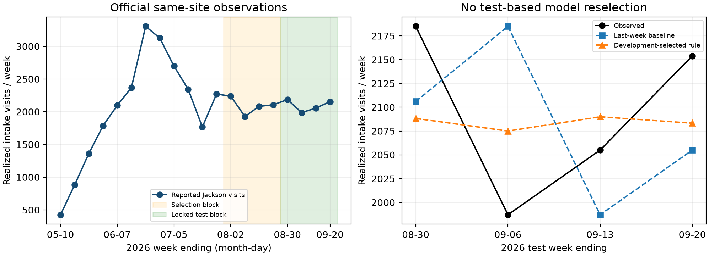
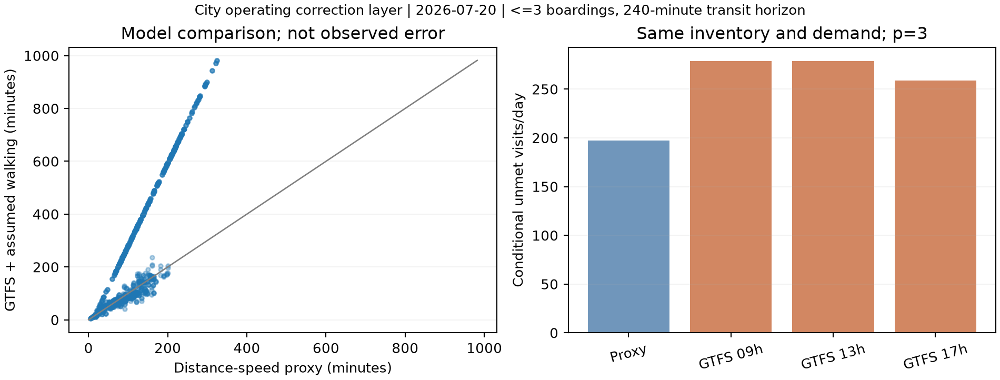

# 本轮建模、代码与验证交付

本包是2026-11-21补全版。先看模型说明、数值结果及证据表，再按manifest命令复算。未把来源重构、数值对拍、排班核验和真实结果检验混成一项。

数值测试：162项通过。历史发布样例的结构/账目检查与当前代码的独立最小割、全序列、资源边界测试分别解释。

## 这次真正补上了什么

1. 官方同站实际周到访的12/4/4时间划分。只用开发期选出的last_4_weeks_mean，测试MAE72.625人次/周；上一周基线111.000，相对差34.57%。复杂模型未过选择门槛，已采用简单基线。
2. 23份官方周报/季末报告、NOAA逐日气温及官方运营刊物，保留源错误与来源冲突、原件和指纹；目标直接取weekly列，不从有修订的累计列造真值。
3. 补主要遗漏Jackson/Justa及Cholla延时的显式运营层。地址采用官方刊物，Census街道插值不冒充实测入口，原MAG快照不修改。500/200日容量是兼容已实现工作量的假设情景，不是测得的容量上限。
4. 原MAG层1152条、修正运营层1224条GTFS参考OD，独立原始旅程核验；与同层距离代理的差别是结构差，不是实测误差。
5. 许可/供电/场地/配员窗口进入供给式；单共享搬迁队计任务间重定位，初始队伍位置固定于事故前。已修复重复overlay、鲁棒标签、零需求公平值、V截断和日上限利用率等新反例。
6. 用人员小时、工资、能耗、耗材和维护推导费用区间，另比较不预知热路径的共享稳健计划。没有拿固定设施合同总额除站点数充作移动单位价格。
7. 补全严格推导/最小割证明、独立审查、模型交接和可复算证据。数字由同一CSV/JSON生成；按用户要求，论文写作与排版暂停，不改队友原稿。

## 同输入运营层对照（p=3，距离/速度代理）

| 网络情景 | 缺口人次/代表日 | 选址 |
|---|---|---|
| MAG_registered | 212.768 | MCH-3,MCH-4,MCH-8 |
| city_Cholla_hours_only | 212.768 | MCH-3,MCH-4,MCH-8 |
| city_hours_and_two_omitted_sites | 197.373 | MCH-3,MCH-4,MCH-8 |

上述对照只改变明确的运营资料/新增站点假设，原区中心、需求和其他容量仍是条件输入。排班OD另用同一运营层比对，见gtfs_city/matched_inventory_siting.csv。

## 验证边界及失败后的动作

周到访检验是回顾性逐周一步计算，假定前周记录已可用；实际发布时延未知，检索时见过一个测试周值，不能称完全盲或已证明可提前一周上线。只有四个相关测试周，不制造独立样本置信区间。它验证一个固定站已实现工作量的有限预测目标，不能推成12区潜在需求或新移动站的真实覆盖率。

GTFS核验支持发布时刻、service日期和权限处理；步行接驳、频率等候、实时延误、无障碍及block续乘仍有限域。若主流水线导入参考OD，明确把一个出发时刻重复用于全部规划时段/日期，只能作统一结构情景，不伪装七日时变实测路由。

没有匹配本题规格的本地完整移动单位采购报价，不能用检索不到的数据编成实测数。费用和吞吐参数保留范围；不依赖这些缺口的数学结论、数据反证和本次狭义检验已实际完成。

三位队员个人理解、签名及本训练具体AI规则的确认无法由程序代办；本包已提供答辩算例与全部复算入口，不把这些人的动作伪写成完成。

图为官方单站周观测与模型预测；训练/选择/测试块、单位和基线在图及CSV中保留。

图是发布排班加假设步行模型与距离代理的比较，非现场行程误差。
